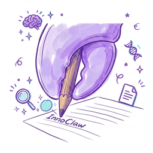
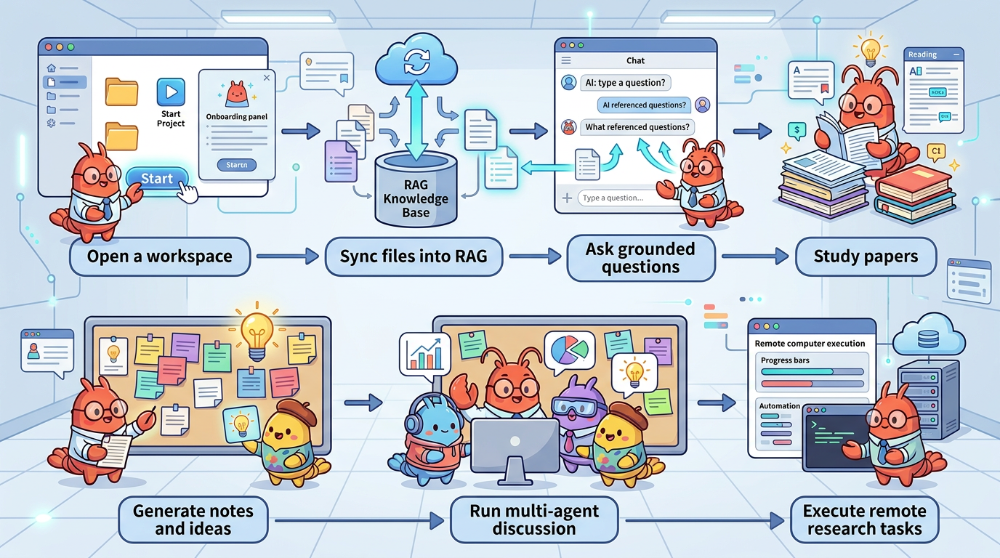
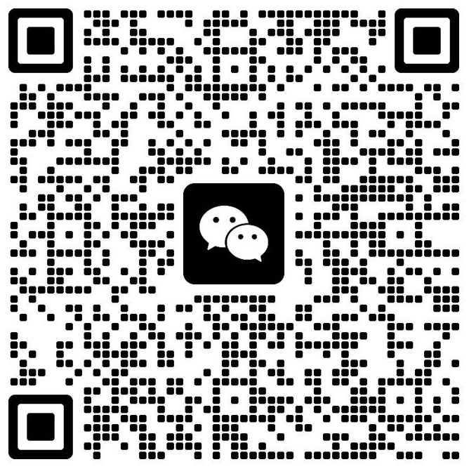

# InnoScale

  

  <b>A self-hosted research workspace for cited answers, paper study, scientific skills, and research execution.</b>

  
  
  

  <b>English</b> · <a href="README_CN.md">简体中文</a>

  <a href="#highlights">Highlights</a> · <a href="#using-InnoScale">How to use</a> · <a href="#get-started">Get started</a> · <a href="#community">Community</a>

InnoScale turns a folder on your server into a research workspace. You read papers, ask questions of your own files, and carry selected work through to execution, without moving between a file browser, a note tool, a paper reader, and a job terminal.

Answers stay attached to the documents you synced. Discussions follow a fixed set of roles. Skills can be reused across studies. High-risk execution steps stop for a person to approve them.

  

## Who it is for

InnoScale is for researchers who want cited answers from their own materials, for engineers who keep code and data beside the papers they read, and for labs that prefer a workspace they host themselves.

## Highlights

- **Cited answers.** After a workspace is synced, questions are answered from the indexed files, with the sources shown.
- **Paper study in one place.** Search ArXiv, PubMed, bioRxiv, and Semantic Scholar, then summarize a paper, discuss it, or turn the reading into research ideas.
- **Structured discussion.** A paper review runs through a moderator, a skeptic, a librarian, a reproducer, and a scribe, so the record is easier to scan than a free-form chat.
- **Reusable scientific skills.** Domain workflows, including drug discovery, genomics, and protein science, can be imported and used again from the agent panel.
- **From reading to execution.** Deep Research carries a study through review points. Remote jobs can be submitted through Shell, Slurm, or `rjob`, and a high-risk step waits for approval.
- **Separate sessions.** Different projects and tabs keep their own agent context.
- **Self-hosted.** The workspace, index, and notes remain on the server you run. Conversation uses Tencent Cloud TokenHub DeepSeek V4.1 Flash and DeepSeek V4 Pro.

## How to use it

### Ask questions of your own files

Create a workspace from a server folder. Sync it, then ask a question. The reply cites the indexed documents. You can also browse, edit, and upload files in that same workspace.

### Study a paper

Open Paper Study in the workspace. Search the literature, open a paper, and generate a summary. From there, start a multi-role discussion or save research ideas into notes.

### Carry the work into execution

Open Deep Research when a remote profile is configured. Review the proposed changes, approve the steps that need a person, submit the job, and read the result back in the workspace.

## Get started

When the service is running, open it in a browser, register, create a workspace, and click Sync.

Installation and deployment are described in [开发说明](docs/开发说明.md). There is no staging environment. The online service is production. Do not deploy a change there until it has been verified locally.

## Community

Questions about installation and deployment belong in [开发说明](docs/开发说明.md). Bugs and feature requests belong in [GitHub Issues](https://github.com/SpectrAI-Initiative/InnoScale/issues). For direct conversation, join the Feishu or WeChat group below.

  
  &nbsp;&nbsp;&nbsp;&nbsp;
  
   
  Scan to join the Feishu or WeChat group

## Project information

- **License** — Apache-2.0, see `LICENSE`
- **Repository** — https://github.com/SpectrAI-Initiative/InnoScale
