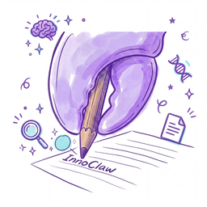
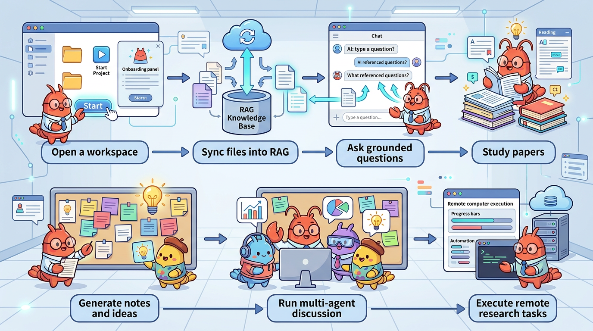

# Innobuddy

  

  <b>可自托管的研究工作台，用于有依据的问答、论文研读、科学技能调用与研究执行。</b>

  
  
  

  <a href="README.md">English</a> · <b>简体中文</b>

  <a href="#highlights">产品亮点</a> · <a href="#using-Innobuddy">如何使用</a> · <a href="#get-started">开始使用</a> · <a href="#community">社区</a>

Innobuddy 把服务器上的文件夹变成研究工作区。论文研读、针对自有文件的提问，以及后续的执行，都在同一处完成，不必在文件浏览、笔记、论文阅读和任务终端之间来回切换。

回答附带所依据的文档。讨论按固定角色进行。技能可以在不同研究中复用。高风险的执行步骤会停下来，等待人工确认。

  

## 适用对象

Innobuddy 面向希望从自有材料中获得有依据回答的研究人员，面向把代码、数据与论文放在一起阅读的工程师，也面向希望自行托管研究环境的实验室。

## 产品亮点

- **有依据的回答。** 工作区完成同步后，提问会基于已索引的文件作答，并给出出处。
- **论文研读集中在一处。** 可检索 ArXiv、PubMed、bioRxiv 与 Semantic Scholar，随后生成摘要、展开讨论，或把阅读转为研究设想。
- **结构化讨论。** 论文评审依次由主持人、质疑者、文献专家、复现者与记录员完成，记录比自由对话更便于查阅。
- **可复用的科学技能。** 药物发现、基因组学、蛋白质科学等领域的工作流可以导入，并在智能体面板中再次使用。
- **从阅读走向执行。** Deep Research 会在检查点暂停。远程任务可通过 Shell、Slurm 或 `rjob` 提交，高风险步骤须经人工批准。
- **会话彼此独立。** 不同项目和标签保留各自的智能体上下文。
- **自行托管。** 工作区、索引和笔记保留在您运行的服务器上。对话使用腾讯云 TokenHub 上的 DeepSeek V4.1 Flash 与 DeepSeek V4 Pro。

## 如何使用

### 针对自有文件提问

用服务器上的文件夹建立一个工作区，完成同步后直接提问。回答会引用已索引的文档。同一工作区中也可以浏览、编辑和上传文件。

### 研读论文

在工作区中打开论文研读。检索文献，打开论文，生成摘要。此后可以开始多角色讨论，或把研究设想保存到笔记。

### 把工作推进到执行

在已经配置远程环境时打开 Deep Research。审阅准备作出的修改，批准需要人工确认的步骤，提交任务，再回到工作区查看结果。

## 开始使用

服务启动后，在浏览器中打开，注册账号，建立工作区，然后点击同步。

安装与部署见 [开发说明](docs/开发说明.md)。目前没有预发环境。线上服务即生产环境。未经本地验证的变更，不应部署到线上。

## 社区

安装与部署方面的问题见 [开发说明](docs/开发说明.md)。缺陷与功能建议请提交到 [GitHub Issues](https://github.com/SpectrAI-Initiative/InnoClaw/issues)。如需直接交流，可加入下方飞书或微信群。

  
  &nbsp;&nbsp;&nbsp;&nbsp;
  
   
  扫码加入飞书或微信群

## 项目信息

- **许可证** — Apache-2.0，见 `LICENSE`
- **仓库** — https://github.com/SpectrAI-Initiative/InnoClaw
